# Relay

[](LICENSE)
[](https://nodejs.org)
[-3776AB?style=for-the-badge&logo=python&logoColor=white)](https://python.org)
[]()

Un framework portable de coordination pour plusieurs agents IA en ligne de commande,
construit autour d'une contrainte : **le contexte est le budget**.

[Read in English](README.md)

---

## Vue d'ensemble

Les agents IA en ligne de commande (Claude Code, Gemini CLI et les autres) mènent bien un
travail complexe chacun de leur côté. Le problème apparaît quand plusieurs d'entre eux
travaillent des mois sur les mêmes projets, depuis plusieurs machines : pas de mémoire
partagée, aucune idée de ce que l'autre a fait, aucun moyen peu coûteux d'arriver à froid et
de savoir où en sont les choses.

La solution évidente, faire lire l'état partagé à chaque agent au démarrage, est la mauvaise :
elle coûtait 12 000 à 15 000 jetons par session avant tout travail. Relay fait l'inverse. Un
hook injecte un **état prédigéré d'environ 1,4 Ko, ciblé sur le projet où l'on se trouve**, et
le réinjecte après chaque compaction. Tout le reste se consulte à la demande, par un index de
recherche local. Ce que lit l'agent, c'est la réponse, pas le corpus.

---

## Fonctionnement

<picture>
  <source media="(prefers-color-scheme: dark)" srcset="docs/diagrams/relay-flow-fr-dark.svg">
  
</picture>

**Chaque règle a un seul propriétaire, sur trois niveaux.** `AGENTS.md` ne garde que les
règles universelles (chargées à chaque session). `RULES/*.md` porte les règles par zone, avec
un frontmatter `paths:` : elles se chargent la première fois que l'agent touche un fichier
concerné. `DECISIONS.md` porte les raisons et les mesures ; il est indexé par le RAG et
jamais chargé d'office.

**L'état est injecté, pas cherché.** `TOOLS/relay-state.mjs` construit `.relay-state.md` et un
`.relay-state/<projet>.md` par projet : statut, dernières sessions *de ce projet*, fichiers de
règles locaux, skills à la demande. Le hook `SessionStart` (`startup|resume|clear|compact`)
choisit le bon d'après le `cwd`.

**Le statut est mesuré, l'intention est déclarée.** `relay-brain.yml` ne porte que l'intention
humaine. `TOOLS/project-scan.mjs` déduit actif / au repos / en sommeil des dates git ou des
fichiers. Si vous déclarez un projet terminé alors qu'il bouge encore, le scan signale le
conflit.

**Un seul écrivain par fichier, pour que plusieurs machines ne s'écrasent jamais.** Chaque
machine écrit son journal dans `LOG/<hôte>.md` ; `RELAY_LOG.md` est généré par fusion. Le brain
peut être découpé en un fichier par machine, par projet et par note (`BRAIN/`) : les
retouches sont reportées par empreinte, les vrais conflits mis de côté. Les fichiers générés
ne sont jamais synchronisés : chaque machine reconstruit les siens.

**La fin de réponse ne coûte presque rien.** Le hook `Stop` demande une entrée de journal une
fois par session, puis lance un seul processus détaché, qui ne reconstruit l'état et l'index
**que si leurs entrées ont changé** (environ 1,1 s, mesuré).

**Chercher avant de lire.** `TOOLS/rag-index.mjs` indexe règles, décisions, skills, projets,
journal et brain dans un index BM25 en JavaScript pur, sans dépendance native.

**Une skill ne coûte rien tant qu'on ne s'en sert pas.** Une skill marquée
`disable-model-invocation: true` n'a pas de description dans le prompt système ; son nom
figure dans l'état injecté et on l'appelle par `/nom`. Les skills natives sont réservées à ce
qu'un agent ne penserait pas à chercher.

**Les agents proposent, l'utilisateur décide.** Ce qui a été appris et mérite de durer part
dans `INBOX/<hôte>/` sous forme de proposition, revue par lot avec `/inbox`. Aucune session ne
réécrit les règles de son propre chef.

**Plusieurs agents sur un même projet : la supervision.** `TOOLS/supervision/` fait tourner un
tableau de bord (superviseur, managers par périmètre, workers). Il génère pour chaque agent
une fiche de reprise que le hook de démarrage réinjecte après `/clear` ou une compaction. Il
refuse une livraison sans branche, sans SHA ou sans check vert **enregistré par le tableau**.
En Python, optionnel, avec ou sans wmux.

---

## Ce qui a été mesuré

Chaque règle ci-dessus vient de la mesure de la version précédente, sur le système interne
dont Relay est la forme publique (un utilisateur, cinq machines, une douzaine de projets).
Raisons et détails : [`DECISIONS.md`](DECISIONS.md).

| Constat | Mesure |
|---|---|
| Le tour de conversation est l'unité qui coûte cher | 4 000 à 11 000 jetons par tour, contre 614 pour toute la consolidation du contexte |
| Travailler depuis le dossier du projet | Même question : 3 tours / 96 665 jetons depuis la racine, **1 tour / 25 728 jetons** depuis le projet |
| Un ordre de lecture au démarrage coûte plus qu'il n'injecte | ~600 jetons injectés, 12 à 15 k jetons de lectures provoquées |
| Seules les règles universelles restent dans le fichier toujours chargé | 16,2 Ko → environ 10 Ko, les règles par zone passent dans `RULES/` |
| Les descriptions de skills coûtent à chaque session | ~0,37 jeton par octet, à chaque session ; zéro avec `disable-model-invocation` |
| Tout reconstruire après chaque réponse gaspille des écritures | ~220 fichiers identiques réécrits par réponse → seulement si les entrées changent, 1,1 s en détaché |
| Deux machines sur un même journal perdent des entrées | 2 entrées perdues en une journée → un fichier par machine, plus aucune perte depuis |
| La skill de supervision était lue en entier par chaque rôle | découpée par rôle : worker −72 %, superviseur −33 % |

La règle qui compte le plus : **avant d'ajouter quoi que ce soit au contexte chargé à chaque
session, mesurer.** Une chaîne `@include` a atteint 21 Ko sans que personne le voie.

---

## Démarrage rapide

```bash
git clone https://github.com/sonical0/relay && cd relay
npm run init
```

`npm run init` crée le brain avec cette machine, installe les hooks, lie les skills, calcule
statuts, index et état, puis affiche ce qu'il reste à faire. On peut le relancer sans risque.
Procédure complète, permissions et passage depuis Relay 2 : [`SETUP.md`](SETUP.md).

> **Cloné avant le 2026-11-17 ?** L'historique a été réécrit ce jour-là et un ancien clone ne
> peut plus faire de pull : recloner, puis suivre « Upgrading from Relay 2 » dans `SETUP.md`.

| Commande | Rôle |
|---|---|
| `npm run init` | Configurer cette machine (idempotent ; `-- --dry-run` pour prévisualiser) |
| `npm run state` | Fusionner le journal, recalculer statuts, index et état injecté |
| `npm run rag -- --query "…"` | Interroger l'index (`--type rules\|convention\|project\|skill\|log\|brain`, `--full`) |
| `npm run brain -- --migrate` | Découper le brain pour plusieurs machines (une fois) |
| `npm run hooks` | Réparer les hooks seuls |
| `npm run supervision -- <projet>` | Lancer une session multi-agents supervisée |
| `npm test` | Lancer les tests des outils (dossiers temporaires uniquement) |

---

## Arborescence

```
relay/
  AGENTS.md                Règles universelles, lues en premier par tout agent
  CLAUDE.md / GEMINI.md    Capacités par agent (minces, incluent AGENTS.md)
  RULES/                   Règles par zone, chargées au contact des fichiers concernés
  DECISIONS.md             Pourquoi chaque règle existe, avec les mesures (RAG : convention)
  relay-brain.template.yml Machines, agents, projets, intention ; devient relay-brain.yml
  relay-start-hook.js      SessionStart : injecte l'état ciblé
  relay-setup-hook.js      Installe et répare les hooks
  relay-stop-hook.js       Stop : contrôle du journal, travaux de fin de réponse détachés
  LOG/<hôte>.md            Journal, un fichier par machine (personnel)
  INBOX/                   Propositions en attente de /inbox (personnel)

  TOOLS/
    relay-init.mjs         Configuration d'une machine en une commande
    relay-after-turn.mjs   Travaux de fin de réponse, déclenchés seulement si les entrées ont changé
    relay-log.mjs          Fusionne LOG/*.md dans RELAY_LOG.md
    relay-brain.mjs        Découpage optionnel du brain dans BRAIN/
    relay-state.mjs        Construit l'état injecté
    project-scan.mjs       Déduit le statut des projets à partir du disque
    rag-index.mjs / rag-query.mjs   Index BM25 et requêtes
    skills-link.mjs        Lie les skills, copie RULES/ dans .claude/rules/
    log-rotate.mjs         Rotation mensuelle du journal et des notes du brain
    new-project.mjs        Crée et déclare un projet
    supervision/           Tableau multi-agents, CLI, hook de garde (Python, optionnel)
    tests/                 node --test, dossiers temporaires uniquement

  SKILLS/                  inbox et supervision livrées ; les vôtres restent personnelles
  PROJECTS/_template/      Fichiers de départ d'un projet
  docs/diagrams/           Schémas du README : source HTML, SVG exporté

  généré, jamais commité ni synchronisé :
  RELAY_LOG.md  relay-projects.derived.yml  .relay-state*  .relay-rag.json
  .claude/skills/  .claude/rules/  .relay-supervision/
```

---

## Règles de conception

Chacune existe parce que son contraire a été essayé.

- **Un seul propriétaire par règle.** Une règle écrite à deux endroits finit par diverger.
- **Le généré et le manuel ne se mélangent jamais.** Un fichier est écrit par un script ou par
  un humain, jamais par les deux.
- **Un seul écrivain par fichier partagé.** Une synchro fichier par fichier garde la dernière
  copie et jette l'autre.
- **Écrire de façon atomique, valider avant la bascule.** `lib/atomic.mjs` : fichier temporaire,
  nouvel essai si Windows verrouille le fichier, relecture avant le renommage.
- **Comparer les chemins par identité, pas par orthographe.** Sous Windows, un même dossier
  arrive en forme courte 8.3 ou longue, dans n'importe quelle casse ; une comparaison stricte
  échoue sans rien dire.
- **Ne commiter que ce qu'on a modifié, vérifier avant de pousser.** `git push` publie toute la
  branche, y compris les commits des autres sessions.
- **Ne jamais croire un « fini » auto-déclaré.** Relancer les vérifications quand un agent
  délégué rend son travail.
- **Mesurer avant d'ajouter** au contexte toujours chargé.

---

## Ajouter un agent CLI

1. Créer `{AGENT}.md` à la racine : inclure `AGENTS.md`, puis les capacités et les limites.
2. L'ajouter sous `agents:` dans `relay-brain.yml`.
3. Si l'outil accepte les commandes slash, ajouter `.{agent}/commands/framework-init.{ext}`.

Les agents autres que Claude ne lisent pas `.claude/skills/` : les renvoyer vers
`SKILLS/<nom>/SKILL.md`.

---

## Ce qui a été retiré, et pourquoi

- **`claims[]`**, **`needs_bootstrap_sync`** : aucun écrivain, aucun lecteur en quatre mois.
- **Le protocole d'entrée obligatoire en 7 étapes** : remplacé par l'état injecté.
- **Le hook d'état sur `UserPromptSubmit`** : ses marqueurs par session faisaient 40 lignes de
  contournement, et son contexte disparaissait à la compaction. `SessionStart` fait les deux
  nativement.
- **Le mode `load: native | rag` du manifeste** : il refaisait à la main ce que
  `disable-model-invocation` fait nativement.
- **Une skill de routage** : 0 déclenchement sur 3. **Des liens de skills par projet** : git
  suivait les jonctions.
- **Le broker et le chat temps réel entre agents** : la coordination passe par le journal,
  le tableau de bord et l'état injecté.

---

## Licence

MIT, voir [LICENSE](LICENSE).
