# Relay

[](LICENSE)
[](https://nodejs.org)
[-3776AB?style=for-the-badge&logo=python&logoColor=white)](https://python.org)
[]()

A portable coordination framework for multi-agent AI CLI workflows — built around one
constraint: **context is the budget**.

[Lire en français](README-fr.md)

---

## Overview

AI CLI agents — Claude Code, Gemini CLI and their peers — handle complex work well on
their own. The trouble starts when several of them work on the same projects for months,
across several machines: no shared memory, no awareness of what the other did, no cheap
way to arrive cold and know where things stand.

The obvious fix — make every agent read the shared state at startup — is the wrong one:
it cost 12,000 to 15,000 tokens per session before any work began. Relay does the
opposite. A hook injects a **pre-digested state of ~1.4 KB, targeted at the project you
are standing in**, and re-injects it after every compaction. Everything else is on demand,
through a local search index. What an agent reads is the answer, not the corpus.

---

## How it works

<picture>
  <source media="(prefers-color-scheme: dark)" srcset="docs/diagrams/relay-flow-dark.svg">
  
</picture>

**Rules have one owner each, in three layers.** `AGENTS.md` holds only the universal
rules (loaded every session). `RULES/*.md` holds per-area rules with a `paths:`
frontmatter, loaded the first time the agent touches a matching file. `DECISIONS.md`
holds the reasons and measurements, indexed by the RAG and never loaded by default.

**State is injected, not fetched.** `TOOLS/relay-state.mjs` builds `.relay-state.md` and
one `.relay-state/<project>.md` per project: status, the last sessions *on that project*,
local rule files, on-demand skills. The `SessionStart` hook (`startup|resume|clear|compact`)
picks one from the `cwd`.

**Status is derived, intent is declared.** `relay-brain.yml` carries human intent only.
`TOOLS/project-scan.mjs` derives active / idle / dormant from git or file dates. Declare a
project done while it keeps moving and the scan reports the conflict.

**One writer per file, so several machines never overwrite each other.** Each machine
writes its journal in `LOG/<host>.md`; `RELAY_LOG.md` is generated by merging them. The
brain can be split into one file per machine, project and note (`BRAIN/`), with edits
reported back by fingerprint and true conflicts set aside. Generated files are never
synced: each machine rebuilds its own.

**The end of a reply is cheap.** The `Stop` hook asks once per session for a journal
entry, then launches one detached process that rebuilds the state and the index **only if
their inputs changed** (~1.1 s, measured).

**Search before read.** `TOOLS/rag-index.mjs` indexes rules, decisions, skills, projects,
journal and brain into a BM25 index in plain JavaScript — no native dependency.

**Skills cost nothing until used.** A skill marked `disable-model-invocation: true` has no
description in the system prompt; it is listed by name in the injected state and invoked
with `/name`. Native skills are kept for what an agent would not think to look for.

**Agents propose, the user decides.** Something learned that should last goes to
`INBOX/<host>/` as a proposal, reviewed in batch with `/inbox`. No session rewrites the
rules on its own. A proposal is a delta (`add | refine | remove`) with a measurement, and a
monthly `/inbox --prune` pass removes what real usage shows is never read.

**Short sessions, picked up where they stopped.** Re-reading a long context costs far more
than any rule file. At the end of a task the agent writes a resume card (≤ 600 bytes) that
the start hook re-injects, then the user runs `/clear`; the status line says "hand over" from
150k tokens. The start hook injects the existing state at once and refreshes it in the
background.

**Hooks for what must always happen.** An instruction is followed usually, a hook always:
`git add .` and `-A` are refused by `permissions.deny`, set by the setup hook. Long tasks
draw a progress bar with an estimated time left in the status line.

**Several agents on one project: supervision.** `TOOLS/supervision/` runs a board
(supervisor, managers by scope, workers), generates a resume sheet per agent that the
start hook re-injects after `/clear` or compaction, and refuses a delivery without a
branch, a SHA and a green check **recorded by the board**. Python, optional, works with or
without wmux.

---

## What it measures

Every rule above came out of measuring the version before it, on the internal system
Relay is the public form of (one user, five machines, a dozen projects). Reasons and
details: [`DECISIONS.md`](DECISIONS.md).

| Finding | Measurement |
|---|---|
| A conversation turn is the expensive unit | 4,000–11,000 tokens per turn, against 614 for the whole context consolidation |
| Work from the project directory | Same question: 3 turns / 96,665 tokens from the root, **1 turn / 25,728 tokens** from the project |
| A startup "read this" order costs more than it injects | ~600 tokens injected, 12–15k tokens of reads provoked |
| Universal rules only in the always-loaded file | 16.2 KB → ~10 KB, per-area rules moved to `RULES/` |
| Skill descriptions are a recurring cost | ~0.37 token per byte, every session — zero with `disable-model-invocation` |
| Rebuilding after every reply wastes writes | ~220 identical files per reply → only when inputs changed, 1.1 s detached |
| Two machines on one journal lose entries | 2 entries lost in a day → one file per machine, 0 since |
| Supervision skill read whole by every role | split by role: worker −72 %, supervisor −33 % |
| Cached context re-read on every call | ~250k tokens per call, ~75 % of the spend → short sessions and a resume card |
| Synchronous start hook | 2 timeouts out of 53, 2.8 s → **0.5 s** with a background refresh |
| Questions chained in one turn | 2.7 stops per hour → one question call per stop, "next" announced |

The rule that matters most: **before adding anything to the context loaded every
session, measure.** An `@include` chain once reached 21 KB without anyone noticing.

---

## Quick start

```bash
git clone https://github.com/sonical0/relay && cd relay
npm run init
```

`npm run init` creates your brain with this machine, installs the hooks, links skills,
builds status, index and state, and prints what is left to do. Re-running it is safe.
Full procedure, permissions and upgrade from Relay 2: [`SETUP.md`](SETUP.md).

> **Cloned before 2026-11-17?** The history was rewritten that day and an old clone cannot
> pull: clone again and follow "Upgrading from Relay 2" in `SETUP.md`.

| Command | What it does |
|---|---|
| `npm run init` | Set this machine up (idempotent; `-- --dry-run` to preview) |
| `npm run state` | Merge the journal, refresh status, index and injected state |
| `npm run rag -- --query "…"` | Query the index (`--type rules\|convention\|project\|skill\|log\|brain`, `--full`) |
| `npm run brain -- --migrate` | Split the brain for several machines (once) |
| `npm run hooks` | Repair the hooks on their own |
| `npm run supervision -- <project>` | Start a supervised multi-agent run |
| `npm run token-scan` | Tokens per project from the transcripts, re-read per call, `--skills` usage |
| `npm run hook-stats` | Hook durations from the transcripts (median, p95, timeouts) |
| `npm test` | Run the tool tests (temp dirs only) |

---

## Layout

```
relay/
  AGENTS.md                Universal rules — read first by every agent
  CLAUDE.md / GEMINI.md    Per-agent capabilities (thin, include AGENTS.md)
  RULES/                   Per-area rules, loaded when matching files are touched
  DECISIONS.md             Why each rule exists, with measurements (RAG kind: convention)
  relay-brain.template.yml Machines, agents, projects, intent — becomes relay-brain.yml
  relay-start-hook.js      SessionStart — injects the targeted state
  relay-setup-hook.js      Installs and repairs the hooks
  relay-stop-hook.js       Stop — journal check, detached after-turn work
  LOG/<host>.md            Journal, one file per machine (personal)
  INBOX/                   Proposals awaiting /inbox review (personal)

  TOOLS/
    relay-init.mjs         One-command machine setup
    relay-after-turn.mjs   End-of-reply work, with a threshold
    relay-log.mjs          Merges LOG/*.md into RELAY_LOG.md
    relay-brain.mjs        Optional brain split into BRAIN/
    relay-state.mjs        Builds the injected state
    project-scan.mjs       Derives project status from disk
    rag-index.mjs / rag-query.mjs   BM25 index and query
    skills-link.mjs        Links skills, copies RULES/ to .claude/rules/
    log-rotate.mjs         Monthly journal and brain-note rotation
    new-project.mjs        Creates and registers a project
    token-scan.mjs         Token usage per project, re-read per call, skill usage
    hook-stats.mjs         Hook durations read from transcripts
    progress.mjs / progress-run.mjs / ci-progress.mjs   Status-line progress bar
    supervision/           Multi-agent board, CLI, guard hook (Python, optional)
    tests/                 node --test, temp dirs only

  SKILLS/                  inbox, supervision, investigate, spec, qa, product-design
  PROJECTS/_template/      Starter files for a project
  docs/diagrams/           README diagrams: HTML source, exported SVG

  generated, never committed nor synced:
  RELAY_LOG.md  relay-projects.derived.yml  .relay-state*  .relay-rag.json
  .claude/skills/  .claude/rules/  .relay-supervision/  .relay-reprise/
```

---

## Design rules

Each one exists because its opposite was tried.

- **One owner per rule.** Duplicated rules drift.
- **Generated and manual never mix.** A file is written by a script or by a human, never both.
- **One writer per shared file.** File-level sync keeps the last copy and drops the other.
- **Write atomically, validate before the swap.** `lib/atomic.mjs`: temp file, Windows lock
  retry, re-parse before rename.
- **Compare paths by identity, not spelling.** On Windows the same directory arrives in 8.3
  or long form, any case; a strict comparison fails in silence.
- **Commit only what you changed, check before pushing.** `git push` publishes the whole
  branch, including other sessions' commits.
- **Never trust a self-declared "done".** Re-run the checks after a delegated agent reports.
- **Measure before adding** to the always-loaded context.

---

## Adding a CLI agent

1. Create `{AGENT}.md` at the root — include `AGENTS.md`, then capabilities and limits.
2. Add it under `agents:` in `relay-brain.yml`.
3. If the CLI has slash commands, add `.{agent}/commands/framework-init.{ext}`.

Non-Claude agents do not read `.claude/skills/` — point them at `SKILLS/<name>/SKILL.md`.

---

## What was removed, and why

- **`claims[]`**, **`needs_bootstrap_sync`** — zero writers, zero readers in four months.
- **The 7-step mandatory entry protocol** — replaced by the injected state.
- **The `UserPromptSubmit` state hook** — its per-session markers were 40 lines of
  workaround, and its context vanished at compaction. `SessionStart` does both natively.
- **The `load: native | rag` manifest mode** — re-implemented by hand what
  `disable-model-invocation` does natively.
- **A routing skill** — 0 self-triggers out of 3. **Per-project skill links** — git
  followed the junctions.
- **The real-time agent broker and chat** — coordination happens through the journal,
  the board and the injected state.

---

## License

MIT — see [LICENSE](LICENSE).
